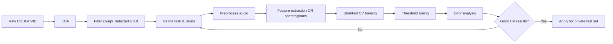

# COUGHVID ML Pipeline Guide

End-to-end documentation for building cough audio classification models using the [COUGHVID dataset (Zenodo v3.0)](https://zenodo.org/records/7024894).

**Local dataset path:** `coughvid_20211012/`  
**Records:** 34,434 audio samples | **Period:** Apr 2020 – Oct 2021  
**License:** [CC BY 4.0](https://creativecommons.org/licenses/by/4.0/)

---

## Table of Contents

1. [Dataset Overview](#1-dataset-overview)
2. [Environment Setup](#2-environment-setup)
3. [Exploratory Data Analysis (EDA)](#3-exploratory-data-analysis-eda)
4. [Data Preprocessing & Filtering](#4-data-preprocessing--filtering)
5. [Feature Engineering](#5-feature-engineering)
6. [Model Selection](#6-model-selection)
7. [Model Development](#7-model-development)
8. [Testing & Evaluation](#8-testing--evaluation)
9. [Recommended Project Structure](#9-recommended-project-structure)
10. [References & Citations](#10-references--citations)

---

## 1. Dataset Overview

### 1.1 Source & Download

| Item | Detail |
|------|--------|
| Zenodo record | [https://zenodo.org/records/7024894](https://zenodo.org/records/7024894) |
| File | `public_dataset_v3.zip` (~2.3 GB) |
| DOI | [10.5281/zenodo.7024894](https://doi.org/10.5281/zenodo.7024894) |
| Paper | [Scientific Data (2021)](https://www.nature.com/articles/s41597-021-00937-4) |

After extraction you get a flat folder (e.g. `coughvid_20211012/`) containing:

```
coughvid_20211012/
├── metadata_compiled.csv          # Master index (51 columns)
├── {uuid}.webm                    # ~85% of audio (Opus, 48 kHz)
├── {uuid}.wav                     # ~10% of audio
├── {uuid}.ogg                     # ~5% of audio
└── {uuid}.json                    # Per-recording metadata subset
```

Each recording is identified by a **UUID v4** filename shared across audio + JSON.

### 1.2 File Formats

| Format | Codec | Sample rate | Notes |
|--------|-------|-------------|-------|
| `.webm` | Opus (VBR) | 48 kHz | Most common |
| `.ogg` | Opus | 48 kHz | Same codec as webm |
| `.wav` | PCM | varies | Less common |

Recordings are up to **10 seconds** long (crowdsourced via mobile/web mic).

### 1.3 Metadata Schema (`metadata_compiled.csv`)

**Context variables**

| Column | Type | Description |
|--------|------|-------------|
| `uuid` | string | Primary key; matches audio filename |
| `datetime` | ISO timestamp | Upload time (UTC) |
| `cough_detected` | float [0, 1] | XGB classifier probability that audio contains a cough |

**Self-reported variables (user questionnaire — optional, many NaNs)**

| Column | Values |
|--------|--------|
| `age` | 1–102 (43% missing) |
| `gender` | `male`, `female`, `other` |
| `latitude`, `longitude` | Rounded to 1 decimal (privacy) |
| `respiratory_condition` | bool — pre-existing condition |
| `fever_muscle_pain` | bool |
| `status` | `healthy`, `symptomatic`, `COVID-19`, or NaN |
| `status_SSL` | Semi-supervised label (v3): `healthy`, `COVID-19`, or NaN |

**Expert labels (4 physicians, suffix `_1` … `_4`)**

| Column pattern | Values |
|----------------|--------|
| `quality_N` | `good`, `ok`, `poor`, `no_cough` |
| `cough_type_N` | `wet`, `dry`, `unknown` |
| `dyspnea_N`, `wheezing_N`, … | bool symptoms |
| `diagnosis_N` | `COVID-19`, `healthy_cough`, `upper_infection`, `lower_infection`, `obstructive_disease`, `no_cough` |
| `severity_N` | `pseudocough`, `mild`, `severe`, `unknown` |

### 1.4 Local Dataset Statistics (your copy)

| Metric | Count |
|--------|-------|
| Total recordings | 34,434 |
| Audio files | ~34,434 (webm: 29,348 · wav: 3,309 · ogg: 1,777) |
| `cough_detected ≥ 0.8` | ~18,544 (recommended cough subset) |
| Self-reported `status` | 20,664 (healthy: 15,476 · symptomatic: 3,873 · COVID-19: 1,315) |
| Expert-labeled (any `diagnosis_*`) | ~2,841 |
| `status_SSL` filled | ~8,331 |

> **Important:** Self-reported labels are noisy. Expert labels are more reliable but sparse and show only *slight* inter-rater agreement on diagnosis (κ ≈ 0.07). Prefer expert labels for pathology tasks; use `status_SSL` cautiously for large-scale COVID screening.

### 1.5 Prediction Tasks You Can Build

| Task | Target label | Recommended subset |
|------|----------------|-------------------|
| Cough vs non-cough | `cough_detected` threshold | All data |
| COVID-19 screening | `status` or `diagnosis_*` | `cough_detected ≥ 0.8` |
| Cough quality | `quality_*` | Expert-labeled only |
| Wet vs dry cough | `cough_type_*` | Expert-labeled only |
| Respiratory pathology | `diagnosis_*` | Expert-labeled only |
| Demographics | `age`, `gender` | Rows with metadata + cough filter |

---

## 2. Environment Setup

### 2.1 Python Dependencies

```bash
python -m venv .venv
source .venv/bin/activate   # Windows: .venv\Scripts\activate

pip install pandas numpy matplotlib seaborn scikit-learn xgboost
pip install librosa soundfile torch torchaudio
pip install jupyter ipykernel tqdm
```

**System tools (required for audio I/O):**

```bash
# macOS
brew install ffmpeg

# Ubuntu/Debian
sudo apt install ffmpeg
```

### 2.2 Configuration

Create a small config module so paths are not hard-coded:

```python
# config.py
from pathlib import Path

DATA_DIR = Path("coughvid_20211012")
METADATA_PATH = DATA_DIR / "metadata_compiled.csv"
COUGH_THRESHOLD = 0.8          # EPFL recommended threshold
TARGET_SR = 12000              # Paper preprocessing sample rate
LOWPASS_HZ = 6000
RANDOM_SEED = 42
```

---

## 3. Exploratory Data Analysis (EDA)

### 3.1 Goals

Before modeling, answer:

1. How many usable cough recordings exist?
2. Is the target class imbalanced?
3. Which metadata fields are complete enough to use?
4. Are there duplicate subjects or geographic/temporal bias?
5. What do cough waveforms and spectrograms look like?

### 3.2 Load & Inspect Metadata

```python
import pandas as pd
import matplotlib.pyplot as plt
import seaborn as sns
from config import METADATA_PATH, DATA_DIR, COUGH_THRESHOLD

df = pd.read_csv(METADATA_PATH, index_col=0)
df["datetime"] = pd.to_datetime(df["datetime"])

print(df.shape)
print(df.info())
print(df["status"].value_counts(dropna=False))
print(df["cough_detected"].describe())
```

### 3.3 EDA Checklist

#### A. Label distribution

```python
fig, axes = plt.subplots(1, 3, figsize=(14, 4))

# Self-reported status
df["status"].value_counts().plot(kind="bar", ax=axes[0], title="Self-reported status")

# Cough detection score histogram
df["cough_detected"].hist(bins=50, ax=axes[1])
axes[1].axvline(COUGH_THRESHOLD, color="red", linestyle="--", label="threshold=0.8")
axes[1].set_title("cough_detected distribution")
axes[1].legend()

# Expert diagnosis (first reviewer)
df["diagnosis_1"].value_counts(dropna=True).plot(kind="bar", ax=axes[2], title="Expert diagnosis_1")

plt.tight_layout()
plt.savefig("eda_label_distribution.png", dpi=150)
```

#### B. Demographics

```python
cough_df = df[df["cough_detected"] >= COUGH_THRESHOLD]

sns.histplot(cough_df["age"].dropna(), bins=30)
plt.title("Age distribution (cough subset)")
plt.savefig("eda_age.png")

cough_df["gender"].value_counts().plot(kind="pie", autopct="%1.1f%%")
plt.title("Gender (cough subset)")
plt.savefig("eda_gender.png")
```

#### C. Temporal & geographic coverage

```python
cough_df.groupby(cough_df["datetime"].dt.to_period("M")).size().plot()
plt.title("Recordings over time")
plt.ylabel("count")
plt.savefig("eda_timeline.png")

# Scatter map (requires lat/lon)
geo = cough_df.dropna(subset=["latitude", "longitude"])
plt.scatter(geo["longitude"], geo["latitude"], alpha=0.3, s=5)
plt.xlabel("longitude"); plt.ylabel("latitude")
plt.title("Geographic distribution")
plt.savefig("eda_geo.png")
```

#### D. Audio file integrity

```python
from pathlib import Path

def resolve_audio_path(uuid: str) -> Path | None:
    for ext in ("webm", "wav", "ogg"):
        p = DATA_DIR / f"{uuid}.{ext}"
        if p.exists():
            return p
    return None

df["audio_path"] = df["uuid"].astype(str).apply(resolve_audio_path)
df["has_audio"] = df["audio_path"].notna()
print(df["has_audio"].value_counts())
missing = df[~df["has_audio"]]
print(f"Missing audio: {len(missing)}")
```

#### E. Listen & visualize samples

```python
import librosa
import librosa.display
import numpy as np

def plot_sample(uuid: str):
    path = resolve_audio_path(uuid)
    y, sr = librosa.load(path, sr=None, mono=True)
    fig, axes = plt.subplots(2, 1, figsize=(12, 5))
    librosa.display.waveshow(y, sr=sr, ax=axes[0])
    axes[0].set_title(f"Waveform — {uuid}")
    S = librosa.feature.melspectrogram(y=y, sr=sr, n_mels=128)
    librosa.display.specshow(librosa.power_to_db(S), sr=sr, ax=axes[1], x_axis="time", y_axis="mel")
    axes[1].set_title("Mel spectrogram")
    plt.tight_layout()
    plt.savefig(f"eda_sample_{uuid[:8]}.png")

# Compare classes
covid_uuid = df[(df["status"] == "COVID-19") & (df["cough_detected"] >= 0.8)].iloc[0]["uuid"]
healthy_uuid = df[(df["status"] == "healthy") & (df["cough_detected"] >= 0.8)].iloc[0]["uuid"]
plot_sample(covid_uuid)
plot_sample(healthy_uuid)
```

#### F. Class imbalance summary (COVID-19 binary task)

```python
task_df = df[(df["cough_detected"] >= COUGH_THRESHOLD) & df["status"].isin(["COVID-19", "healthy"])]
print(task_df["status"].value_counts(normalize=True))
# Expect ~8% COVID-19 — plan for class weighting / oversampling
```

### 3.4 EDA Deliverables

Save these artifacts before modeling:

- `eda_report.md` or notebook with plots
- Filtered CSV: `metadata_cough_subset.csv` (`cough_detected ≥ 0.8`)
- Task-specific CSV: e.g. `metadata_covid_binary.csv`
- List of broken/missing audio UUIDs

---

## 4. Data Preprocessing & Filtering

Follow the [official paper pipeline](https://www.nature.com/articles/s41597-021-00937-4) for consistency.

### 4.1 Recommended Filters

```python
def build_working_set(df, task="covid_binary"):
    base = df[df["has_audio"]].copy()

    # Step 1: Keep likely coughs (EPFL recommendation)
    base = base[base["cough_detected"] >= COUGH_THRESHOLD]

    if task == "covid_binary":
        base = base[base["status"].isin(["COVID-19", "healthy"])]
        base["label"] = (base["status"] == "COVID-19").astype(int)

    elif task == "expert_covid":
        # Use physician impression instead of self-report
        base = base[base["diagnosis_1"].notna()]
        base = base[base["diagnosis_1"].isin(["COVID-19", "healthy_cough"])]
        base["label"] = (base["diagnosis_1"] == "COVID-19").astype(int)

    elif task == "wet_dry":
        base = base[base["cough_type_1"].isin(["wet", "dry"])]
        base["label"] = base["cough_type_1"].map({"dry": 0, "wet": 1})

    return base.reset_index(drop=True)
```

### 4.2 Audio Loading & Standardization

```python
import librosa
import numpy as np
from scipy.signal import butter, filtfilt

def lowpass_filter(y, sr, cutoff=6000, order=5):
    nyq = 0.5 * sr
    b, a = butter(order, cutoff / nyq, btype="low")
    return filtfilt(b, a, y)

def load_and_preprocess(path, target_sr=12000, max_duration=10.0):
    y, sr = librosa.load(path, sr=None, mono=True)
    y = y / (np.max(np.abs(y)) + 1e-8)          # normalize to [-1, 1]
    y = lowpass_filter(y, sr, cutoff=6000)
    y = librosa.resample(y, orig_sr=sr, target_sr=target_sr)
    max_len = int(max_duration * target_sr)
    if len(y) > max_len:
        y = y[:max_len]
    else:
        y = np.pad(y, (0, max_len - len(y)))    # pad shorter clips
    return y.astype(np.float32), target_sr
```

### 4.3 Cough Segmentation (optional, from paper)

The paper segments individual cough events using a **hysteresis comparator on signal power**:

1. Normalize → lowpass 6 kHz → downsample 12 kHz  
2. Detect power spikes (cough expiratory phase ≈ 230–550 ms)  
3. Discard segments < 200 ms  
4. Extend each segment by ±200 ms  

Use segmentation when extracting per-cough features; use full-clip features for end-to-end deep models.

### 4.4 Train/Validation/Test Split

**Never split randomly by recording without considering leakage.** Prefer:

| Strategy | When to use |
|----------|-------------|
| **Stratified K-Fold** | Default for imbalanced labels |
| **Group by UUID** | One recording = one subject assumption |
| **Temporal split** | Test on later dates to simulate deployment |
| **Hold-out expert set** | Keep all expert-labeled rows for final validation |

```python
from sklearn.model_selection import StratifiedKFold

def get_splits(df, label_col="label", n_splits=5, seed=42):
    skf = StratifiedKFold(n_splits=n_splits, shuffle=True, random_state=seed)
    for train_idx, val_idx in skf.split(df, df[label_col]):
        yield df.iloc[train_idx], df.iloc[val_idx]
```

---

## 5. Feature Engineering

The COUGHVID cough-detector uses **68 hand-crafted audio features** (see paper Table 2). You can reuse this approach or learn features with neural networks.

### 5.1 Feature Categories (Classical ML)

| Category | Examples | Library |
|----------|----------|---------|
| Time-domain | RMS energy, zero-crossing rate, kurtosis | `librosa` |
| Spectral | Centroid, bandwidth, rolloff, flux | `librosa` |
| MFCC | 13–40 coefficients + deltas | `librosa.feature.mfcc` |
| PSD bands | 8 hand-selected frequency bands | custom / paper code |
| Chroma / tonnetz | Pitch class profiles | `librosa` |

### 5.2 Extract Features (sklearn-ready)

```python
import librosa
import numpy as np
import pandas as pd
from tqdm import tqdm

def extract_features(y, sr):
    feats = {}
    feats["rms"] = float(np.mean(librosa.feature.rms(y=y)))
    feats["zcr"] = float(np.mean(librosa.feature.zero_crossing_rate(y)))
    feats["centroid"] = float(np.mean(librosa.feature.spectral_centroid(y=y, sr=sr)))
    feats["bandwidth"] = float(np.mean(librosa.feature.spectral_bandwidth(y=y, sr=sr)))
    feats["rolloff"] = float(np.mean(librosa.feature.spectral_rolloff(y=y, sr=sr)))

    mfcc = librosa.feature.mfcc(y=y, sr=sr, n_mfcc=20)
    for i in range(20):
        feats[f"mfcc_{i}_mean"] = float(np.mean(mfcc[i]))
        feats[f"mfcc_{i}_std"] = float(np.std(mfcc[i]))

    # PSD band energies (simplified — paper uses 8 custom bands)
    S = np.abs(librosa.stft(y)) ** 2
    freqs = librosa.fft_frequencies(sr=sr)
    bands = [(0, 500), (500, 1000), (1000, 2000), (2000, 3000),
             (3000, 4000), (4000, 5000), (5000, 6000)]
    for lo, hi in bands:
        mask = (freqs >= lo) & (freqs < hi)
        feats[f"psd_{lo}_{hi}"] = float(np.mean(S[mask]))

    return feats

def build_feature_matrix(df):
    rows = []
    for _, row in tqdm(df.iterrows(), total=len(df)):
        y, sr = load_and_preprocess(row["audio_path"])
        f = extract_features(y, sr)
        f["uuid"] = row["uuid"]
        f["label"] = row["label"]
        rows.append(f)
    return pd.DataFrame(rows)
```

**Cache features to disk** (`features.parquet`) — extraction over ~18k files takes hours.

### 5.3 Deep Learning Features

| Input representation | Shape | Model family |
|---------------------|-------|--------------|
| Raw waveform | `(1, 120000)` @ 12 kHz × 10 s | 1D CNN, WaveNet |
| Log-Mel spectrogram | `(128, T)` | 2D CNN, ResNet |
| MFCC image | `(40, T)` | CRNN |
| OpenL3 / YAMNet embeddings | `(T, D)` | Transfer learning + classifier |

```python
import torch
import torchaudio

def waveform_to_melspec(y, sr=12000, n_mels=128):
    y_tensor = torch.tensor(y).unsqueeze(0)
    mel = torchaudio.transforms.MelSpectrogram(
        sample_rate=sr, n_mels=n_mels, n_fft=1024, hop_length=256
    )(y_tensor)
    log_mel = torchaudio.transforms.AmplitudeToDB()(mel)
    return log_mel.squeeze(0).numpy()  # (n_mels, time)
```

### 5.4 Metadata as Features (multimodal)

Combine audio features with tabular metadata:

```python
meta_cols = ["age", "gender", "respiratory_condition", "fever_muscle_pain"]
# One-hot encode gender; impute age with median
```

Use only metadata available at inference time (no label leakage from `status` into features when predicting `status`).

---

## 6. Model Selection

### 6.1 Model Comparison Matrix

| Approach | Pros | Cons | Best for |
|----------|------|------|----------|
| **XGBoost / Random Forest** on hand-crafted features | Fast, interpretable, matches EPFL baseline | Manual feature design | Baseline, small data, expert labels |
| **SVM + MFCC** | Strong classic baseline | Poor scaling | Quick experiments |
| **1D/2D CNN** on spectrograms | Learns temporal patterns | Needs GPU, more data | COVID screening at scale |
| **CRNN / AST / wav2vec2** | State-of-the-art audio | Heavy compute | Research-grade accuracy |
| **Ensemble** (XGB + CNN) | Often best AUC | Complex deployment | Competition / publication |

### 6.2 Selection Criteria

Choose models based on:

1. **Metric priority:** Medical screening favors **high recall (sensitivity)** for COVID-19; use precision-recall curves, not accuracy alone.
2. **Data size:** ~1,300 self-reported COVID samples → expect overfitting with large deep nets unless using augmentation or SSL labels.
3. **Label quality:** Expert labels (~280 COVID expert positives in `diagnosis_1`) → prefer simpler models.
4. **Deployment target:** Edge/mobile → small CNN or XGB; server → larger transformer.

### 6.3 Baseline Experiment Order

```
1. XGBoost + 68 features     → establish baseline AUC
2. Logistic Regression       → sanity check
3. 2D CNN on log-Mel         → deep learning baseline̦
4. Tune threshold on PR curve → optimize sensitivity/specificity tradeoff
5. Ensemble best 2 models    → final candidate
```

### 6.4 Hyperparameter Starting Points

**XGBoost (binary COVID):**

```python
params = {
    "n_estimators": 300,
    "max_depth": 5,
    "learning_rate": 0.05,
    "subsample": 0.8,
    "colsample_bytree": 0.8,
    "scale_pos_weight": 12,   # ~healthy:COVID ratio
    "eval_metric": "auc",
    "random_state": 42,
}
```

**CNN (mel spectrogram):**

- Optimizer: Adam, lr=1e-3 with ReduceLROnPlateau  
- Batch size: 32  
- Augmentation: time shift, gain, background noise, SpecAugment  
- Early stopping on val AUC (patience=10)

---

## 7. Model Development

### 7.1 Classical ML Pipeline

```python
from sklearn.pipeline import Pipeline
from sklearn.preprocessing import StandardScaler
from sklearn.impute import SimpleImputer
from xgboost import XGBClassifier
from sklearn.model_selection import cross_val_score

feature_cols = [c for c in feat_df.columns if c not in ("uuid", "label")]
X = feat_df[feature_cols]
y = feat_df["label"]

pipe = Pipeline([
    ("imputer", SimpleImputer(strategy="median")),
    ("scaler", StandardScaler()),
    ("clf", XGBClassifier(**params)),
])

scores = cross_val_score(pipe, X, y, cv=5, scoring="roc_auc")
print(f"AUC: {scores.mean():.3f} ± {scores.std():.3f}")
pipe.fit(X, y)
```

### 7.2 PyTorch CNN Sketch

```python
import torch.nn as nn

class CoughCNN(nn.Module):
    def __init__(self, n_mels=128, n_classes=2):
        super().__init__()
        self.features = nn.Sequential(
            nn.Conv2d(1, 32, 3, padding=1), nn.BatchNorm2d(32), nn.ReLU(), nn.MaxPool2d(2),
            nn.Conv2d(32, 64, 3, padding=1), nn.BatchNorm2d(64), nn.ReLU(), nn.MaxPool2d(2),
            nn.Conv2d(64, 128, 3, padding=1), nn.BatchNorm2d(128), nn.ReLU(), nn.AdaptiveAvgPool2d(1),
        )
        self.classifier = nn.Linear(128, n_classes)

    def forward(self, x):
        x = self.features(x).squeeze(-1).squeeze(-1)
        return self.classifier(x)
```

### 7.3 Handling Class Imbalance

```python
# Option A: class weights in loss
pos_weight = (y == 0).sum() / max((y == 1).sum(), 1)

# Option B: oversample minority in DataLoader
from torch.utils.data import WeightedRandomSampler

# Option C: SMOTE on feature matrix (classical ML only)
from imblearn.over_sampling import SMOTE
```

### 7.4 Data Augmentation (audio)

```python
def augment(y, sr):
    # Random gain
    y = y * np.random.uniform(0.7, 1.3)
    # Time shift
    shift = np.random.randint(-sr // 10, sr // 10)
    y = np.roll(y, shift)
    # Add noise
    y = y + np.random.randn(len(y)) * 0.005
    return np.clip(y, -1, 1)
```

### 7.5 Experiment Tracking

Log for every run:

- Git commit hash, random seed, filter criteria  
- Train/val/test sizes and class ratios  
- All metrics (AUC, sensitivity, specificity, F1)  
- Confusion matrix and PR curve  
- Model checkpoint path  

Use MLflow, Weights & Biases, or a simple CSV log.

---

## 8. Testing & Evaluation

### 8.1 Metrics

| Metric | Formula / meaning | When it matters |
|--------|-------------------|-----------------|
| **AUROC** | Area under ROC | Overall ranking quality |
| **AUPRC** | Area under PR curve | **Imbalanced COVID task** |
| **Sensitivity (Recall)** | TP / (TP + FN) | Catch COVID cases |
| **Specificity** | TN / (TN + FP) | Avoid false alarms |
| **F1** | Harmonic mean P/R | Balanced single score |

```python
from sklearn.metrics import (
    roc_auc_score, average_precision_score,
    classification_report, confusion_matrix, RocCurveDisplay
)

y_prob = pipe.predict_proba(X_val)[:, 1]
print("AUROC:", roc_auc_score(y_val, y_prob))
print("AUPRC:", average_precision_score(y_val, y_prob))
print(classification_report(y_val, y_prob >= 0.5, target_names=["healthy", "COVID-19"]))
```

### 8.2 Threshold Tuning

Default 0.5 is rarely optimal for screening:

```python
from sklearn.metrics import precision_recall_curve

prec, rec, thresholds = precision_recall_curve(y_val, y_prob)
# Pick threshold for target sensitivity, e.g. 90%
target_sens = 0.90
idx = np.argmin(np.abs(rec - target_sens))
chosen_threshold = thresholds[idx]
```

### 8.3 Cross-Validation Protocol

```python
from sklearn.model_selection import StratifiedKFold, cross_validate

scoring = {
    "auc": "roc_auc",
    "ap": "average_precision",
    "f1": "f1",
}

cv = StratifiedKFold(n_splits=5, shuffle=True, random_state=42)
results = cross_validate(pipe, X, y, cv=cv, scoring=scoring)
for k, v in results.items():
    if k.startswith("test_"):
        print(k, v.mean(), "±", v.std())
```

Report **mean ± std** across folds (matches EPFL paper style).

### 8.4 Error Analysis

After validation, inspect:

- **False negatives:** COVID labeled as healthy — listen to audio  
- **False positives:** Healthy labeled COVID — check `cough_detected`, background noise  
- **Confusion by `quality_1`:** poor recordings hurt performance  
- **Confusion by device format:** webm vs wav  

```python
errors = val_df[(y_val != (y_prob >= chosen_threshold))].copy()
errors["prob"] = y_prob
errors.sort_values("prob").head(20)  # review lowest-confidence mistakes
```

### 8.5 Private Test Set (Official Benchmark)

The dataset maintainers hold out **625 recordings** not in the public zip. To evaluate on it:

1. Train and tune using **cross-validation on public data only**  
2. Email **coughvid@epfl.ch** with your CV results and methodology  
3. Receive unlabeled private audio  
4. Submit predictions → receive official metrics  

Details: [Zenodo record — Private Set section](https://zenodo.org/records/7024894)

### 8.6 Sanity Tests Before Deployment

```python
# Unit tests
assert load_and_preprocess(path)[0].shape[0] == 12000 * 10
assert np.max(np.abs(y)) <= 1.0 + 1e-6

# Smoke test: random noise should not predict COVID with high confidence
noise = np.random.randn(120000).astype(np.float32) * 0.01
# prob should be near majority class rate
```

### 8.7 Reproducibility Checklist

- [ ] Fixed `RANDOM_SEED` everywhere (numpy, sklearn, torch)  
- [ ] Saved `requirements.txt` with pinned versions  
- [ ] Documented exact filter: `cough_detected >= 0.8`, label source  
- [ ] Saved train/val/test UUID lists (no overlap)  
- [ ] Reported confidence intervals across CV folds  
- [ ] Stated limitations (self-reported labels, no clinical validation)

---

## 9. Recommended Project Structure

```
cough_project/
├── coughvid_20211012/           # Raw data (do not commit to git)
├── data/
│   ├── metadata_cough_subset.csv
│   ├── metadata_covid_binary.csv
│   ├── splits/
│   │   ├── fold_0_train.csv
│   │   └── fold_0_val.csv
│   └── features.parquet           # Cached features
├── notebooks/
│   ├── 01_eda.ipynb
│   ├── 02_feature_extraction.ipynb
│   └── 03_model_training.ipynb
├── src/
│   ├── config.py
│   ├── audio.py                   # load, filter, augment
│   ├── features.py                # hand-crafted extraction
│   ├── dataset.py                 # PyTorch Dataset
│   ├── models/
│   │   ├── xgb_baseline.py
│   │   └── cnn.py
│   └── evaluate.py
├── models/                        # Saved checkpoints
├── reports/
│   ├── eda/
│   └── metrics/
├── requirements.txt
└── DOCUMENTATION.md               # This file
```

### Suggested Workflow



---

## 10. References & Citations

If you use this dataset, cite:

> Orlandic, L., Teijeiro, T. & Atienza, D. The COUGHVID crowdsourcing dataset, a corpus for the study of large-scale cough analysis algorithms. *Scientific Data* **8**, 156 (2021). https://doi.org/10.1038/s41597-021-00937-4

**Dataset DOI:** [10.5281/zenodo.7024894](https://doi.org/10.5281/zenodo.7024894)

### Key Takeaways from the Paper

| Topic | Recommendation |
|-------|----------------|
| Cough filter | Use `cough_detected ≥ 0.8` (95.4% precision) |
| Preprocessing | Lowpass 6 kHz → downsample 12 kHz → normalize |
| Expert labels | Useful but low inter-rater agreement on diagnosis |
| v3 SSL labels | `status_SSL` in `metadata_compiled.csv` — semi-supervised expansion |
| Official code | Was at [c4science.ch/diffusion/10770](https://c4science.ch/diffusion/10770/) (service discontinued Jul 2025); reimplement from paper |

### Disclaimer

Models trained on COUGHVID are **research prototypes only**. They are not FDA/CE-approved medical devices and must not be used for clinical diagnosis without proper validation and regulatory review.

---

*Generated for the local `coughvid_20211012` copy in this repository. Statistics reflect that snapshot as of documentation date.*
